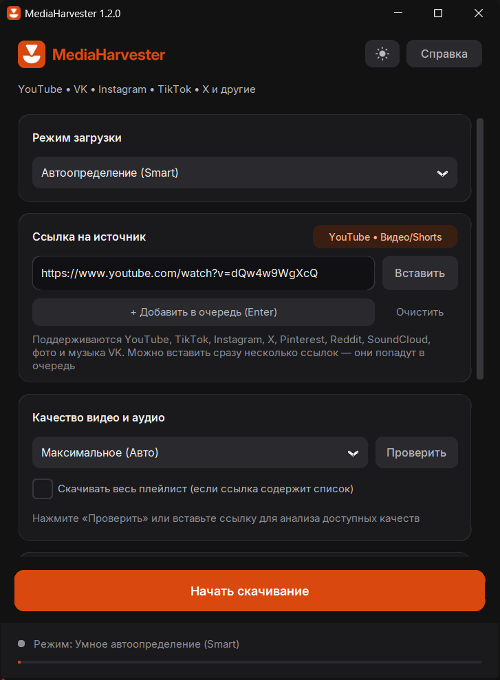
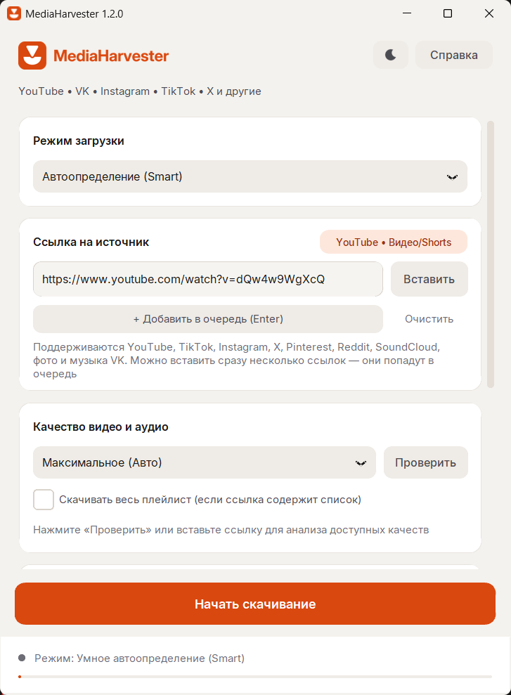
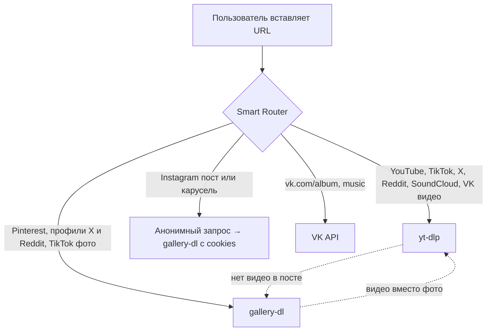

# 🌾 MediaHarvester

<p align="center">
  
</p>

<p align="center">
  <strong>Современный высокопроизводительный мультимедийный комбайн</strong><br>
  Универсальная загрузка видео, аудио, фотоальбомов и каруселей в оригинальном качестве.<br>
  <strong>YouTube • TikTok • Instagram • X • Pinterest • Reddit • SoundCloud • ВКонтакте</strong>
</p>

<p align="center">
  <a href="https://github.com/Voidhmslf/MediaHarvester/releases"></a>
  <a href="https://www.python.org/downloads/"></a>
  <a href="https://github.com/TomSchimansky/CustomTkinter"></a>
  
  <a href="LICENSE"></a>
  
</p>

<p align="center">
  
  &nbsp;&nbsp;
  
</p>

---

## 📑 Содержание

- [✨ Особенности и преимущества](#-особенности-и-преимущества)
- [🎯 Поддерживаемые платформы](#-поддерживаемые-платформы)
- [🧠 Умный роутер ссылок (Smart Router)](#-умный-роутер-ссылок-smart-router)
- [📥 Очередь ссылок](#-очередь-ссылок)
- [📸 Instagram: что работает без входа](#-instagram-что-работает-без-входа)
- [🎵 Музыка: треки по списку и ограничения VK](#-музыка-треки-по-списку-и-ограничения-vk)
- [🛑 Безопасная отмена загрузки](#-безопасная-отмена-загрузки)
- [📂 Архитектура проекта](#-архитектура-проекта)
- [🧪 Тесты](#-тесты)
- [🚀 Быстрый старт из исходников](#-быстрый-старт-из-исходников)
- [📦 Сборка в автономный `.exe` (PyInstaller)](#-сборка-в-автономный-exe-pyinstaller)
- [🍪 Руководство: Cookies](#-руководство-cookies)
- [🔑 Вход в ВКонтакте](#-вход-в-вконтакте)
- [❓ Часто задаваемые вопросы (FAQ)](#-часто-задаваемые-вопросы-faq)
- [🗺️ План развития (Roadmap)](#-план-развития-roadmap)
- [🤝 Вклад в разработку (Contributing)](#-вклад-в-разработку-contributing)
- [📜 Лицензия](#-лицензия)

---

## ✨ Особенности и преимущества

- **Бесплатно и с открытым кодом:** никаких подписок, рекламы, водяных знаков и ограничений скорости.
- **Лучшее доступное качество:** видео до 4K с автосклейкой дорожек, фото в максимальном размере, MP3 до 320 kbps с тегами.
- **Умный роутер:** вставьте ссылку, и приложение само выберет движок (yt-dlp, gallery-dl, VK API), покажет платформу и нужные настройки.
- **Очередь ссылок:** вставьте сразу несколько ссылок; ошибка одной не останавливает остальные, неудавшиеся можно запустить повторно.
- **Быстрые фотоальбомы VK:** 8 потоков, повторы при сбоях, докачка и отчёт `_failed.txt`; если крупный вариант фото недоступен, берётся следующий по размеру.
- **Instagram без входа:** Reels, публичные посты и карусели качаются без аккаунта; cookies нужны только для закрытых аккаунтов и Stories.
- **Треки по списку:** вставьте список «Исполнитель — Название», и приложение найдёт и скачает каждый трек в MP3 с тегами, не обращаясь к VK.
- **Само обновляется там, где ломается чаще всего:** yt-dlp обновляется автоматически (с проверкой SHA-256), при старте проверяется ffmpeg.
- **Понятные ошибки:** вместо трассировок короткая причина и подсказка, кнопка «Подробнее» с отчётом для разработчика; лог с маскировкой токенов.
- **Светлая и тёмная тема:** кнопка в шапке переключает оформление на лету, выбор запоминается (в «Справке» есть вариант «Как в системе»). Фирменные цвета и шрифт Inter, главная кнопка закреплена внизу окна.
- **Автономный FFmpeg**, безопасная отмена загрузки и защита воркеров PyInstaller от «fork-бомбы».
- **Настройки хранятся локально** в `%LOCALAPPDATA%\MediaHarvester\settings.json` (в открытом виде; токены не шифруются, не передавайте этот файл другим).

---

## 🎯 Поддерживаемые платформы

| Сервис | Что скачивается | Нужен ли вход |
| :--- | :--- | :--- |
| **YouTube** | Видео до 4K, Shorts, YouTube Music, плейлисты, аудио в MP3 до 320 kbps с тегами | Нет (для 18+ и «вы не бот» — cookies) |
| **TikTok** | Видео, профиль целиком, фотопосты и слайдшоу | Нет |
| **X (Twitter)** | Видео и фото в постах, медиа профиля (до 500 файлов) | Иногда cookies |
| **Instagram** | **Reels**, **публичные посты и карусели** (фото и видео) без входа; Stories и закрытые аккаунты | Для Stories и закрытых — cookies |
| **Pinterest** | Пины и доски (до 500 файлов) | Нет |
| **Reddit** | Видео, изображения, галереи, сабреддиты и профили (до 500 файлов) | Нет |
| **SoundCloud** | Треки, плейлисты, профили целиком | Нет |
| **ВКонтакте** | Фотоальбомы в максимальном размере, видео и клипы | Для альбомов — токен |
| **ВКонтакте (музыка)** | **Ограничено:** VK закрыл музыкальный API для сторонних программ, см. раздел «Музыка» | Токен, работает нестабильно |
| **Треки по списку** | MP3 из YouTube по списку «Исполнитель — Название» | Нет |
| **Любой сайт, поддержанный yt-dlp** | Универсальный загрузчик видео | Зависит от сайта |

---

## 🧠 Умный роутер ссылок (Smart Router)

Модуль [`src/core/router.py`](src/core/router.py) разбирает входящий URL по хосту и пути (не по подстроке), определяет платформу, тип контента и подходящий движок.



- **Автоопределение:** платформа отображается бейджем рядом с полем ссылки.
- **Динамический интерфейс:** показываются только нужные карточки (качество, токен, cookies).
- **Автоматические откаты:** если пост оказался фото вместо видео (или наоборот), приложение само переключает движок без зацикливания.
- **Ручной режим:** Smart Mode можно отключить и выбрать режим вручную.

---

## 📥 Очередь ссылок

Вставьте сразу несколько ссылок (по одной в строке) или добавляйте по одной клавишей Enter / кнопкой «Добавить в очередь».
Ссылки скачиваются по порядку, в статусе виден номер `[2/5]`. Ошибка на одной ссылке не останавливает остальные; неудавшиеся остаются в списке с причиной,
и повторный запуск скачивает только их. «Остановить скачивание» прерывает всю очередь.

---

## 📸 Instagram: что работает без входа

- **Reels:** без входа (через yt-dlp).
- **Публичные посты и карусели:** без входа. Приложение анонимно запрашивает данные поста у Instagram (так же работают сайты-загрузчики), берёт все слайды в максимальном размере и скачивает фото и видео напрямую с CDN.
- **Stories и закрытые аккаунты:** нужны cookies. В блоке «Cookies» можно выбрать браузер, где вы вошли в Instagram (лучше всего **Firefox**; для Chrome, Edge и Opera браузер нужно закрыть на время скачивания), либо указать файл `cookies.txt`; файл главнее браузера.
- Если анонимный запрос не удался (закрытый аккаунт, лимит запросов), приложение автоматически пробует gallery-dl.

> ⚠️ Анонимный доступ держится на внутренних механизмах yt-dlp и может временно ограничиваться Instagram. yt-dlp обновляется автоматически; если что-то перестанет работать, используйте cookies.

---

## 🎵 Музыка: треки по списку и ограничения VK

**Режим «Треки по списку (поиск на YouTube)»** не использует VK вообще. Вставьте строки вида `Исполнитель — Название` (нумерация и пустые строки допускаются; список можно скопировать из плейлиста или из архива данных VK). Приложение найдёт каждый трек на YouTube, выберет оригинал (канал «Topic», официальное аудио; лайвы, каверы, ремиксы и часовые петли отсекаются) и сохранит MP3 с тегами исполнителя и названия в папку `Треки_по_списку`. Уже скачанное пропускается, ненайденное записывается в `_not_found.txt`.

**Режим «Музыка ВК»** зависит от того, что VK разрешает сторонним программам, а музыкальные методы API VK закрыл. Токен Kate Mobile сейчас получает ошибки 9 и 3, токены сторонних приложений — ошибку 15. Поэтому:
- используйте «Треки по списку» как основной способ;
- кнопка **«⚠ Эксперимент: войти как официальное приложение VK»** пробует вход от имени приложения VK для Android. Это **нарушает правила VK и может привести к ограничениям или блокировке аккаунта**; перед включением показывается предупреждение, пользуйтесь запасным аккаунтом.

---

## 🛑 Безопасная отмена загрузки

При запуске задачи кнопка **«Скачать»** превращается в яркую кнопку **«Остановить скачивание»**.

1. GUI переходит в неблокирующий режим с живым логом и индикатором прогресса.
2. При нажатии «Остановить» взводится потокобезопасный флаг `threading.Event`.
3. Модули загрузки (`yt-dlp`, `gallery-dl`, `vk_api`) немедленно перехватывают сигнал отмены, завершают фоновые подпроцессы и удаляют временные файлы (`.part`).
4. Интерфейс мгновенно возвращается в исходное состояние без зависаний и утечек ресурсов.

---

## 📂 Архитектура проекта

```text
MediaHarvester/
├── assets/
│   ├── logo.ico                 # Иконка окна и .exe (из брендбука)
│   ├── brand/                   # Логотип для шапки приложения и README
│   └── fonts/                   # Inter (Regular, Medium, SemiBold, Bold) и его лицензия OFL
├── MediaHarvester-brand/        # Брендбук: логотипы, иконки для всех платформ, цветовые токены
├── docs/                        # Скриншоты для README
├── main.py                      # Точка входа; воркеры PyInstaller (--gallery-dl-worker, --vk-login-worker)
├── MediaHarvester.spec          # Спецификация PyInstaller (standalone .exe)
├── requirements.txt             # Зависимости
├── src/
│   ├── config.py                # Режимы, адреса авторизации, SettingsManager (токены фото/музыки раздельно)
│   ├── core/                    # Логика без интерфейса
│   │   ├── router.py            # Умный роутер ссылок: платформа, тип, движок
│   │   ├── download_queue.py    # Очередь ссылок: разбор текста, последовательный запуск, статусы
│   │   ├── ytdlp_engine.py      # yt-dlp: видео/аудио, плейлисты, откат на gallery-dl
│   │   ├── gallery_engine.py    # gallery-dl: фото, галереи, ленты (Instagram, X, Pinterest, Reddit, TikTok)
│   │   ├── insta_engine.py      # Тонкая обёртка над gallery_engine для Instagram
│   │   ├── track_search.py      # «Треки по списку»: поиск на YouTube, выбор оригинала, MP3 с тегами
│   │   ├── vk_engine.py         # VK: фотоальбомы (потоки, ретраи, докачка), музыка через vkpymusic
│   │   ├── vk_auth.py           # Вход в VK: браузер + буфер обмена, встроенное окно (pywebview)
│   │   └── vk_diag.py           # Диагностика токена VK (какие методы API отвечают)
│   ├── ui/                      # Окно приложения, собранное из миксинов
│   │   ├── app.py               # MediaHarvesterApp: состояние и сборка миксинов
│   │   ├── theme.py             # Палитра светлой и тёмной тем, шрифты Inter, готовые стили виджетов
│   │   ├── shell.py             # Шапка, статус-бар, окно «Подробнее», переключение экранов и тем
│   │   ├── downloader_cards.py  # Главный экран: режим, ссылка, качество, cookies, папка
│   │   ├── queue_panel.py       # Очередь ссылок
│   │   ├── tracklist_panel.py   # Режим «Треки по списку»
│   │   ├── vk_token_panel.py    # Токен VK, вход, экспериментальный клиент, проверка токена
│   │   ├── download_runner.py   # Запуск и отмена скачивания, выбор движка
│   │   ├── edit_keys.py         # Буфер обмена и Ctrl+V/C/X/A в любой раскладке
│   │   ├── engine_status.py     # Проверка ffmpeg и автообновление yt-dlp при старте
│   │   └── info_view.py         # Экран «Справка»
│   └── utils/
│       ├── helpers.py           # FFmpeg, пути, имена файлов, папка данных приложения
│       ├── logger.py            # Лог с ротацией и маскировкой токенов
│       ├── errors.py            # Перевод технических ошибок в понятные сообщения
│       ├── report.py            # Отчёт об ошибках для разработчика
│       ├── clipboard.py         # Буфер обмена через Win32 (Tk-буфер «залипает»)
│       └── ytdlp_updater.py     # Автообновление yt-dlp с проверкой SHA-256
├── tests/                       # Автотесты (unittest)
└── README.md
```

Окно `MediaHarvesterApp` не содержит логики скачивания: каждый миксин отвечает за свою часть интерфейса, а
движки в `src/core` ничего не знают об интерфейсе и принимают `progress_callback` и `cancel_event`.

---

## 🧪 Тесты

```bash
python -m unittest discover -s tests -t .
```

Тесты не ходят в сеть (сервер и yt-dlp подменяются) и не пишут в ваш профиль. GUI-тесты открывают настоящее
окно на рабочем столе Windows и пропускаются, если задать переменную окружения `MH_SKIP_GUI=1`.

| Файл | Что проверяет |
| :--- | :--- |
| `test_router.py` | определение платформы, типа и движка по ссылке |
| `test_core_helpers.py` | настройки, хелперы, форматы yt-dlp, gallery-dl, обёртка Instagram |
| `test_vk_photos.py`, `test_vk_auth.py`, `test_vk_diag.py` | фото VK (потоки, ретраи, докачка), вход, диагностика |
| `test_tracks.py`, `test_music_tokens_input.py` | «Треки по списку», токены, ввод и горячие клавиши |
| `test_errors.py`, `test_ytdlp_updater.py` | понятные ошибки, лог, автообновление yt-dlp |
| `test_ui_structure.py` | состав окна, выбор движка для каждой ссылки, карточки, очередь |
| `test_theme.py` | палитра (контраст текста в обеих темах), переключение темы, шрифты и бренд-ресурсы |

---

## 🚀 Быстрый старт из исходников

### Требования
- Python **3.11** или новее.
- Установленный Git.

### 1. Клонирование репозитория
```bash
git clone https://github.com/Voidhmslf/MediaHarvester.git
cd MediaHarvester
```

### 2. Создание виртуального окружения
```bash
# Windows
python -m venv .venv
.venv\Scripts\Activate.ps1

# Linux / macOS
python3 -m venv .venv
source .venv/bin/activate
```

### 3. Установка зависимостей
```bash
pip install --upgrade pip
pip install -r requirements.txt
```

> **Примечание:** В проект включена библиотека `imageio_ffmpeg`, поэтому скачивать и прописывать бинарный файл `ffmpeg` вручную **не требуется** — он подключится автоматически.

### 4. Запуск приложения
```bash
python main.py
```

---

## 📦 Сборка в автономный `.exe` (PyInstaller)

Для создания единого переносимого файла `.exe` (Python на целевом ПК не нужен) используется готовая спецификация:

```bash
pip install pyinstaller
pyinstaller --clean --noconfirm MediaHarvester.spec
```

Готовый файл появится в `dist/MediaHarvester.exe`. Версия берётся из [`src/version.py`](src/version.py) и попадает в свойства файла (Проводник → Свойства → Подробно).

### 🛡️ Особенности реализации сборщика
- Стандартный вызов `sys.executable -m gallery_dl` в собранном приложении перезапускал бы основное окно («fork-бомба»). Поэтому `main.py` перехватывает служебные флаги `--gallery-dl-worker` и `--vk-login-worker` и запускает нужный модуль напрямую.
- `MediaHarvester.spec` упаковывает ffmpeg, темы `customtkinter`, иконку и окно входа `pywebview`, а из сборки исключает ненужные пакеты (`scipy`, `pandas`, `numpy`, Jupyter и др.): итоговый файл около 105 МБ.
- **Не заменяйте `.exe`, пока приложение запущено:** запущенная копия не сможет стартовать рабочие процессы (ошибка «Security validation failure»). Закройте все окна и запустите новый файл.

---

## 🍪 Руководство: Cookies

Cookies нужны, только если без них не обойтись: Stories и закрытые аккаунты Instagram, видео YouTube 18+ и «подтвердите, что вы не бот», часть контента X.
Публичные посты, карусели и Reels Instagram скачиваются без них.

### Вариант 1: взять из браузера (проще)
В блоке **«Cookies»** выберите браузер, где вы вошли в аккаунт: Firefox, Chrome, Edge, Opera, Opera GX, Brave или Vivaldi.
Лучше всего работает **Firefox**. У браузеров на Chromium база cookies занята, пока браузер открыт, поэтому его нужно закрыть на время скачивания; у новых версий Chrome шифрование может мешать чтению совсем.

### Вариант 2: файл `cookies.txt`
1. Установите расширение, например [Get cookies.txt LOCALLY](https://chrome.google.com/webstore/detail/get-cookiestxt-locally/cclelndahbckbenkjhflpdbgdldlbecc).
2. Войдите в аккаунт на нужном сайте и нажмите **Export** (формат Netscape).
3. В MediaHarvester нажмите **«Обзор»** в строке «Файл Cookies» и выберите сохранённый файл. **Файл главнее браузера.**

> 🔒 **Безопасность:** cookies читаются локально и никуда не отправляются; в логах и отчётах они маскируются.

---

## 🔑 Вход в ВКонтакте

Токен нужен для фотоальбомов (и для музыки, если она у вас работает). Токены **для фото и для музыки разные** (их выдают разные приложения VK), поэтому хранятся раздельно и подставляются сами при смене режима.

1. Нажмите **«Войти через ВКонтакте»**: откроется ваш браузер со страницей VK.
2. Нажмите «Продолжить», затем скопируйте адрес страницы: `Ctrl+L`, `Ctrl+C`. Программа сама заберёт токен из буфера обмена и сразу очистит его.
3. Кнопка **«Проверить токен»** показывает, какие методы VK отвечают, а подробности пишет в лог (без самого токена).
4. Запасные способы: встроенное окно входа (VK ID может не отдавать в нём токен) и ручная вставка ссылки или токена.

Логин и пароль программа не видит и не хранит. Токен сохраняется в `%LOCALAPPDATA%\MediaHarvester\settings.json` в открытом виде.

---

## ❓ Часто задаваемые вопросы (FAQ)

<details>
<summary><strong>В: Почему видео на YouTube скачивалось максимум в 360p?</strong></summary>
<br>
YouTube отдельно хранит видеопотоки высокого качества (1080p, 2K, 4K) и аудио. Для их склейки нужен FFmpeg. В шапке программы должна быть строка вида <code>ffmpeg 7.1…</code>; если она красная, переустановите программу.
</details>

<details>
<summary><strong>В: Instagram просит войти. Нужны ли cookies?</strong></summary>
<br>
Для Reels, публичных постов и каруселей cookies не нужны: приложение запрашивает их анонимно. Если Instagram всё же отказал (закрытый аккаунт, Stories, временный лимит), выберите браузер в блоке «Cookies» или укажите файл <code>cookies.txt</code>.
</details>

<details>
<summary><strong>В: Почему не скачивается музыка из VK?</strong></summary>
<br>
VK закрыл музыкальные методы API для сторонних программ: токены отвечают ошибками 3, 9 или 15. Используйте режим «Треки по списку»: он ищет те же треки на YouTube и не требует токена VK.
</details>

<details>
<summary><strong>В: Часть фото из альбома VK не скачалась.</strong></summary>
<br>
Откройте <code>_failed.txt</code> в папке альбома и запустите ту же ссылку ещё раз: докачаются только недостающие фото. Если у фото недоступны все размеры, значит, оно удалено или скрыто на серверах VK.
</details>

<details>
<summary><strong>В: Где лог и как отправить отчёт об ошибке?</strong></summary>
<br>
После ошибки нажмите «Подробнее»: там причина, подсказка и кнопки «Скопировать отчёт» и «Открыть папку логов» (<code>%LOCALAPPDATA%\MediaHarvester\logs</code>). Токены и ключи в ссылках в логе скрываются.
</details>

<details>
<summary><strong>В: Windows Defender ругается на MediaHarvester.exe. Что делать?</strong></summary>
<br>
Это типичное ложное срабатывание на файлы, собранные PyInstaller без платной цифровой подписи. Код открыт, вы можете собрать файл сами по инструкции выше.
</details>

---

## 🗺️ План развития (Roadmap)

- [x] Умный роутер ссылок, безопасная отмена загрузки, автономная сборка в `.exe`.
- [x] YouTube: видео до 4K, плейлисты, MP3 до 320 kbps с тегами.
- [x] Очередь ссылок.
- [x] TikTok, X, Pinterest, Reddit, SoundCloud.
- [x] Instagram: Reels, публичные посты и карусели без входа; cookies из браузера.
- [x] VK: быстрые фотоальбомы с докачкой, вход через браузер, раздельные токены.
- [x] Треки по списку (замена закрытой музыке VK).
- [x] Автообновление yt-dlp, понятные ошибки и лог.
- [ ] Режим «без перекодирования» для музыки (m4a/opus вместо MP3).
- [ ] Параллельная загрузка нескольких ссылок из очереди.
- [x] Светлая и тёмная тема, фирменный стиль.
- [ ] Проверка работы на Linux и macOS.

---

## 🤝 Вклад в разработку (Contributing)

Мы приветствуем предложения, отчеты об ошибках и пулл-реквесты!
1. Сделайте Fork репозитория.
2. Создайте свою ветку фичи: `git checkout -b feature/AmazingFeature`.
3. Закоммитьте изменения: `git commit -m 'feat: Add AmazingFeature'`.
4. Отправьте ветку в Origin: `git push origin feature/AmazingFeature`.
5. Откройте Pull Request.

---

## 📜 Лицензия

Проект распространяется под свободной лицензией **MIT**. Подробности в файле [LICENSE](LICENSE).

Шрифт [Inter](https://rsms.me/inter/) (© The Inter Project Authors) входит в сборку по лицензии SIL Open Font License 1.1, текст лежит в `assets/fonts/Inter-LICENSE.txt`.

<p align="center">
  Сделано с ❤️ для удобной и быстрой работы с медиа.
</p>
