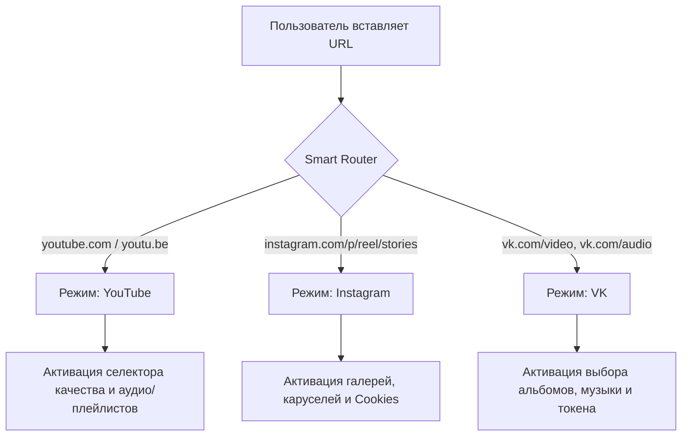

# 🌾 MediaHarvester

<p align="center">
  
</p>

<p align="center">
  <strong>Современный высокопроизводительный мультимедийный комбайн</strong><br>
  Универсальная загрузка видео, аудио, фотоальбомов и каруселей в оригинальном качестве.<br>
  <strong>YouTube • Instagram • ВКонтакте</strong>
</p>

<p align="center">
  <a href="https://github.com/Voidhmslf/MediaHarvester/releases"></a>
  <a href="https://www.python.org/downloads/"></a>
  <a href="https://github.com/TomSchimansky/CustomTkinter"></a>
  <a href="LICENSE"></a>
  
</p>

---

## 📑 Содержание

- [✨ Особенности и преимущества](#-особенности-и-преимущества)
- [🎯 Поддерживаемые платформы](#-поддерживаемые-платформы)
- [🧠 Умный роутер ссылок (Smart Router)](#-умный-роутер-ссылок-smart-router)
- [🛑 Безопасная отмена загрузки](#-безопасная-отмена-загрузки)
- [📂 Архитектура проекта](#-архитектура-проекта)
- [🧪 Тесты](#-тесты)
- [🚀 Быстрый старт из исходников](#-быстрый-старт-из-исходников)
- [📦 Сборка в автономный `.exe` (PyInstaller)](#-сборка-в-автономный-exe-pyinstaller)
- [🍪 Руководство: Экспорт Cookies](#-руководство-экспорт-cookies)
- [🔑 Получение токена ВКонтакте](#-получение-токена-вконтакте)
- [❓ Часто задаваемые вопросы (FAQ)](#-часто-задаваемые-вопросы-faq)
- [🗺️ План развития (Roadmap)](#-план-развития-roadmap)
- [📜 Лицензия](#-лицензия)

---

## ✨ Особенности и преимущества

- **100% Free & Open Source:** Никаких платных подписок, ограничений скорости, рекламы и водяных знаков.
- **Оригинальное качество без потерь:** Загрузка напрямую с серверов в максимальном доступном разрешении (вплоть до 4K 60fps и MP3 320 kbps) без перекодирования и даунгрейда.
- **Эстетичный Fluent Design:** Тёмный интерфейс в стиле Windows 11 на базе `CustomTkinter` с адаптивной сеткой, отзывчивыми индикаторами прогресса и бейджами статуса.
- **Автономный FFmpeg:** Автоматическое обнаружение системного `ffmpeg` с прозрачным фоллбэком на встроенный бинарник `imageio_ffmpeg` — не требует ручной настройки `PATH`.
- **Встроенная защита PyInstaller:** Специальный защитный механизм от циклического перезапуска GUI при вызове сабпроцессов `gallery-dl` внутри скомпилированного `.exe`.
- **Умное кэширование параметров:** Папка назначения, токен VK и путь к cookies сохраняются в `settings.json` и восстанавливаются при следующем запуске.

---

## 🎯 Поддерживаемые платформы

| Сервис | Тип контента | Возможности и особенности |
| :--- | :--- | :--- |
| **YouTube** | Видео | Поддержка разрешений **от 360p до 4K (2160p) 60fps** с автосклейкой лучшего видео- и аудиопотока через FFmpeg. |
| **YouTube** | Аудио (MP3) | Извлечение звука в качестве до **320 kbps** с автоматической записью ID3-тегов (исполнитель, название, обложка альбома). |
| **YouTube** | Shorts & Music | Полная совместимость с короткими видео и треками YouTube Music. |
| **YouTube** | Плейлисты | Пакетное скачивание целых плейлистов в структурированную подпапку с поддержкой паузы/отмены. |
| **Instagram** | Фото & Карусели | Скачивание одиночных постов, смешанных каруселей (фото + видео вместе) в оригинальном разрешении через `gallery-dl`. |
| **Instagram** | Reels & Stories | Скачивание Reels с **двусторонним резервированием** (`gallery-dl` ↔ `yt-dlp`) и приватных историй через Cookies. |
| **ВКонтакте** | Фотоальбомы | Скачивание альбомов в оригинальном качестве. Алгоритм выбирает максимальный размер по площади (`w * h`), а для архивных фото — строгий приоритет типов (`w` > `z` > `y`). |
| **ВКонтакте** | Аудиозаписи | Скачивание до **1000 треков** за один запуск из профилей и плейлистов с декодированием HLS-потоков через `vkpymusic`. |
| **ВКонтакте** | VK Видео & Клипы | Быстрое скачивание роликов и клипов в лучшем доступном качестве. |

---

## 🧠 Умный роутер ссылок (Smart Router)

В приложении реализован модуль [`src/core/router.py`](src/core/router.py), анализирующий входящий URL с помощью оптимизированных регулярных выражений:



- **Автоопределение платформы:** Тип источника моментально отображается цветным бейджем над полем ввода.
- **Динамический интерфейс:** Панели настроек автоматически подстраиваются под выбранную платформу (скрываются нерелевантные параметры).
- **Ручной режим:** При необходимости вы можете в один клик отключить Smart Mode и выбрать платформу вручную.

---

## 🛑 Безопасная отмена загрузки

При запуске задачи кнопка **«Скачать»** превращается в яркую кнопку **«Остановить скачивание»**.

1. GUI переходит в неблокирующий режим с живым логом и индикатором прогресса.
2. При нажатии «Остановить» взводится потокобезопасный флаг `threading.Event`.
3. Модули загрузки (`yt-dlp`, `gallery-dl`, `vk_api`) немедленно перехватывают сигнал отмены, завершают фоновые подпроцессы и удаляют временные файлы (`.part`).
4. Интерфейс мгновенно возвращается в исходное состояние без зависаний и утечек ресурсов.

---

## 📂 Архитектура проекта

```text
MediaHarvester/
├── assets/logo.ico              # Иконка приложения
├── main.py                      # Точка входа; воркеры PyInstaller (--gallery-dl-worker, --vk-login-worker)
├── MediaHarvester.spec          # Спецификация PyInstaller (standalone .exe)
├── requirements.txt             # Зависимости
├── src/
│   ├── config.py                # Палитра, режимы, адреса авторизации, SettingsManager (токены фото/музыки раздельно)
│   ├── core/                    # Логика без интерфейса
│   │   ├── router.py            # Умный роутер ссылок: платформа, тип, движок
│   │   ├── download_queue.py    # Очередь ссылок: разбор текста, последовательный запуск, статусы
│   │   ├── ytdlp_engine.py      # yt-dlp: видео/аудио, плейлисты, откат на gallery-dl
│   │   ├── gallery_engine.py    # gallery-dl: фото, галереи, ленты (Instagram, X, Pinterest, Reddit, TikTok)
│   │   ├── insta_engine.py      # Тонкая обёртка над gallery_engine для Instagram
│   │   ├── track_search.py      # «Треки по списку»: поиск на YouTube, выбор оригинала, MP3 с тегами
│   │   ├── vk_engine.py         # VK: фотоальбомы (потоки, ретраи, докачка), музыка через vkpymusic
│   │   ├── vk_auth.py           # Вход в VK: браузер + буфер обмена, встроенное окно (pywebview)
│   │   └── vk_diag.py           # Диагностика токена VK (какие методы API отвечают)
│   ├── ui/                      # Окно приложения, собранное из миксинов
│   │   ├── app.py               # MediaHarvesterApp: состояние и сборка миксинов
│   │   ├── shell.py             # Шапка, статус-бар, окно «Подробнее», переключение экранов
│   │   ├── downloader_cards.py  # Главный экран: режим, ссылка, качество, cookies, папка
│   │   ├── queue_panel.py       # Очередь ссылок
│   │   ├── tracklist_panel.py   # Режим «Треки по списку»
│   │   ├── vk_token_panel.py    # Токен VK, вход, экспериментальный клиент, проверка токена
│   │   ├── download_runner.py   # Запуск и отмена скачивания, выбор движка
│   │   ├── edit_keys.py         # Буфер обмена и Ctrl+V/C/X/A в любой раскладке
│   │   ├── engine_status.py     # Проверка ffmpeg и автообновление yt-dlp при старте
│   │   └── info_view.py         # Экран «Справка»
│   └── utils/
│       ├── helpers.py           # FFmpeg, пути, имена файлов, папка данных приложения
│       ├── logger.py            # Лог с ротацией и маскировкой токенов
│       ├── errors.py            # Перевод технических ошибок в понятные сообщения
│       ├── report.py            # Отчёт об ошибках для разработчика
│       ├── clipboard.py         # Буфер обмена через Win32 (Tk-буфер «залипает»)
│       └── ytdlp_updater.py     # Автообновление yt-dlp с проверкой SHA-256
├── tests/                       # Автотесты (unittest)
└── README.md
```

Окно `MediaHarvesterApp` не содержит логики скачивания: каждый миксин отвечает за свою часть интерфейса, а
движки в `src/core` ничего не знают об интерфейсе и принимают `progress_callback` и `cancel_event`.

---

## 🧪 Тесты

```bash
python -m unittest discover -s tests -t .
```

Тесты не ходят в сеть (сервер и yt-dlp подменяются) и не пишут в ваш профиль. GUI-тесты открывают настоящее
окно на рабочем столе Windows и пропускаются, если задать переменную окружения `MH_SKIP_GUI=1`.

| Файл | Что проверяет |
| :--- | :--- |
| `test_router.py` | определение платформы, типа и движка по ссылке |
| `test_core_helpers.py` | настройки, хелперы, форматы yt-dlp, gallery-dl, обёртка Instagram |
| `test_vk_photos.py`, `test_vk_auth.py`, `test_vk_diag.py` | фото VK (потоки, ретраи, докачка), вход, диагностика |
| `test_tracks.py`, `test_music_tokens_input.py` | «Треки по списку», токены, ввод и горячие клавиши |
| `test_errors.py`, `test_ytdlp_updater.py` | понятные ошибки, лог, автообновление yt-dlp |
| `test_ui_structure.py` | состав окна, выбор движка для каждой ссылки, карточки, очередь |

---

## 🚀 Быстрый старт из исходников

### Требования
- Python **3.11** или новее.
- Установленный Git.

### 1. Клонирование репозитория
```bash
git clone https://github.com/Voidhmslf/MediaHarvester.git
cd MediaHarvester
```

### 2. Создание виртуального окружения
```bash
# Windows
python -m venv .venv
.venv\Scripts\Activate.ps1

# Linux / macOS
python3 -m venv .venv
source .venv/bin/activate
```

### 3. Установка зависимостей
```bash
pip install --upgrade pip
pip install -r requirements.txt
```

> **Примечание:** В проект включена библиотека `imageio_ffmpeg`, поэтому скачивать и прописывать бинарный файл `ffmpeg` вручную **не требуется** — он подключится автоматически.

### 4. Запуск приложения
```bash
python main.py
```

---

## 📦 Сборка в автономный `.exe` (PyInstaller)

Для создания единого переносимого файла `.exe` (не требующего наличия Python на целевом ПК) используется готовый файл спецификации:

```bash
pip install pyinstaller
pyinstaller --clean MediaHarvester.spec
```

После завершения компиляции готовый файл появится в папке:
```text
dist/MediaHarvester.exe
```

### 🛡️ Особенности реализации сборщика
При компиляции с `gallery-dl` стандартный вызов `sys.executable -m gallery_dl` приводит к перезапуску основного GUI приложения («fork bomb»). В **MediaHarvester** эта проблема элегантно решена:
1. `MediaHarvester.spec` автоматически упаковывает бинарники `ffmpeg`, темы `customtkinter` и иконку `assets/logo.ico`.
2. Входной файл `main.py` перехватывает флаг `--gallery-dl-worker` и направляет исполнение напрямую в модуль `gallery_dl.main()`, обеспечивая стабильную работу без дублирования окон.

---

## 🍪 Руководство: Экспорт Cookies

Файл `cookies.txt` необходим для:
- Загрузки контента из **закрытых (private) аккаунтов Instagram** (на которые вы подписаны).
- Обхода временных ограничений и капчи Instagram.
- Доступа к видео YouTube с возрастным ограничением (18+).

### Пошаговая инструкция:
1. Установите расширение для браузера:
   - [Get cookies.txt LOCALLY](https://chrome.google.com/webstore/detail/get-cookiestxt-locally/cclelndahbckbenkjhflpdbgdldlbecc) (для Chrome, Edge, Brave, Opera)
   - Или аналогичное расширение для Firefox.
2. Войдите в свой аккаунт на `instagram.com` или `youtube.com`.
3. Откройте расширение и нажмите **Export** (формат Netscape).
4. Сохраните файл как `cookies.txt`.
5. В интерфейсе MediaHarvester нажмите кнопку **«Обзор»** в строке **«Файл Cookies»** и выберите сохранённый файл.

> 🔒 **Безопасность:** Файл `cookies.txt` хранится только локально на вашем компьютере и никуда не отправляется. Он автоматически добавлен в `.gitignore` во избежание случайной публикации.

---

## 🔑 Получение токена ВКонтакте

Для скачивания вашей музыки или фотоальбомов из закрытых сообществ/профилей ВК:
1. Получите токен пользователя ВКонтакте с правами `photos` и `audio` (например, через VK Admin или доверенные утилиты авторизации).
2. Вставьте полученный токен в поле **«VK Токен»**.
3. Токен сохранится в зашифрованном локальном профиле приложения (`settings.json`).

---

## ❓ Часто задаваемые вопросы (FAQ)

<details>
<summary><strong>В: Почему видео на YouTube скачивалось максимум в 360p?</strong></summary>
<br>
YouTube разделяет видеопотоки высокого качества (1080p, 2K, 4K) и аудиопотоки. Чтобы получить файл высокого разрешения, их необходимо объединить с помощью FFmpeg. Если FFmpeg недоступен, YouTube отдает только устаревший объединенный формат 360p. В MediaHarvester встроен автоматический поиск FFmpeg и резервный бинарник <code>imageio_ffmpeg</code>, благодаря чему качество 1080p, 1440p и 4K работает прямо из коробки!
</details>

<details>
<summary><strong>В: Почему при скачивании из Instagram возникает ошибка «Login Required»?</strong></summary>
<br>
Instagram активно блокирует анонимные запросы с частых IP-адресов. Чтобы скачивать без ограничений, прикрепите файл <code>cookies.txt</code> из браузера, где вы авторизованы в Instagram.
</details>

<details>
<summary><strong>В: Антивирус Windows Defender ругается на скомпилированный MediaHarvester.exe. Что делать?</strong></summary>
<br>
Это стандартное ложное срабатывание (False Positive) эвристических алгоритмов на файлы, собранные через PyInstaller без платной цифровой подписи (EV Certificate). Проект полностью открыт, исходный код прозрачен. Вы можете добавить исполняемый файл в исключения антивируса либо запускать проект напрямую из исходников: <code>python main.py</code>.
</details>

---

## 🗺️ План развития (Roadmap)

- [x] Автоматический умный роутер ссылок (Smart Router).
- [x] Instagram: поддержка одиночных фото, каруселей, Reels и Stories.
- [x] ВКонтакте: фотоальбомы в максимальном разрешении и музыка до 1000 треков.
- [x] YouTube: видео до 4K, плейлисты, аудио 320 kbps с ID3-метаданными.
- [x] Безопасная отмена загрузки без зависания интерфейса.
- [x] Автономная сборка в `.exe` с защитой воркера `gallery-dl`.
- [ ] Очередь задач для параллельного / пакетного скачивания произвольного списка URL.
- [ ] Поддержка TikTok (скачивание видео без водяных знаков и аудиодорожек).
- [ ] Поддержка Pinterest (скачивание пинов и досок в полном разрешении).
- [ ] Переключение светлой / тёмной темы оформления.

---

## 🤝 Вклад в разработку (Contributing)

Мы приветствуем предложения, отчеты об ошибках и пулл-реквесты!
1. Сделайте Fork репозитория.
2. Создайте свою ветку фичи: `git checkout -b feature/AmazingFeature`.
3. Закоммитьте изменения: `git commit -m 'feat: Add AmazingFeature'`.
4. Отправьте ветку в Origin: `git push origin feature/AmazingFeature`.
5. Откройте Pull Request.

---

## 📜 Лицензия

Проект распространяется под свободной лицензией **MIT**. Подробности в файле [LICENSE](LICENSE).

<p align="center">
  Сделано с ❤️ для удобной и быстрой работы с медиа.
</p>
